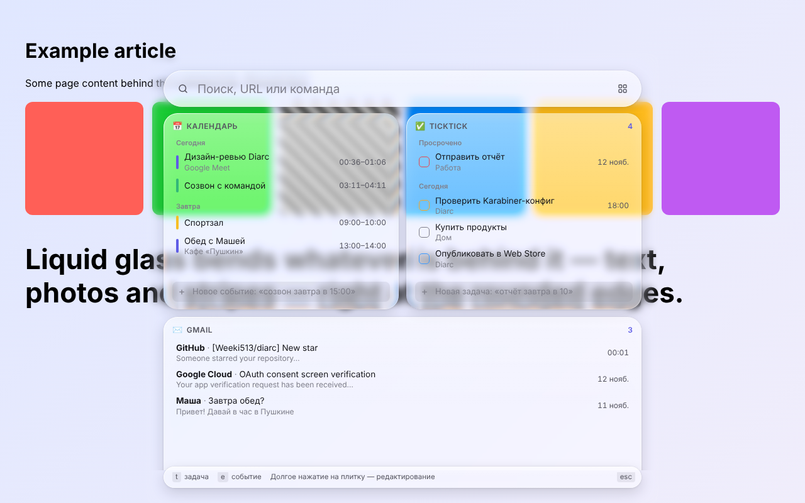

# Diarc

Командная строка в стиле Arc для браузера [Dia](https://www.diabrowser.com/). По `⌘T` поверх текущей страницы
мгновенно появляется бар: поиск по вкладкам, истории и закладкам, команды для вкладок и плитки виджетов
(Google Календарь, Gmail, TickTick и свои).



**[English below](#in-english)** · [Скачать последний релиз](https://github.com/Weeki513/diarc/releases/latest)

## Зачем

Мне было неудобно, что при открытии поиска в Dia открывается новая вкладка. Хотелось вернуть простоту, которая была в Arc:
там по `⌘T` открывалась не новая вкладка, а строка ввода прямо поверх текущей страницы. Я долго ждал чего-то подобного
от The Browser Company, но устал ждать и сделал сам.

Заодно хотелось больше свободы и функциональности. Так появились виджеты и простой способ добавлять свои.
И немного красоты и самовыражения. Так появились ASCII-анимации.

Поэтому, когда выдалась пара свободных часов, я сделал это расширение. Сейчас оно доступно на GitHub, а скоро появится
в [Chrome Web Store](https://chromewebstore.google.com/category/extensions).

<p>
  
  
  
  
</p>

## Что умеет

- **Поиск** как в адресной строке: подсказки из интернета (Google или DuckDuckGo, можно выключить), сайты, открытые
  вкладки, закладки и история в одном списке. `↵` открывает в новой вкладке, `⇧↵` в текущей, `⌘⌫` закрывает найденную вкладку.
- **Tab-поиск по сайту** как в Arc: `youtube` → `Tab` → запрос ищется на YouTube. Встроено ~30 сайтов, свои добавляются в
  настройках, сайты с OpenSearch, которые вы посещаете, подхватываются сами.
- **Цвет сайта**: строка поиска окрашивается в цвет выбранного сайта (популярные домены заданы, остальные по фавиконке).
- **Существа**: пиксельные ASCII-создания (скаты, светлячки, ласточки, черепахи, листья) плавают по сайтам под стеклом бара
  или во вкладке «Аквариум». Всё настраивается, свои добавляются одним файлом: **[docs/CREATURES.md](docs/CREATURES.md)**.
- **Жидкое стекло**: строка поиска и плитки — отдельные куски стекла, которые преломляют страницу у краёв (SVG-фильтр
  под iframe). В настройках можно переключить на матовое стекло или выключить.
- **Команды**: закрыть, дублировать, закрепить вкладку, закрыть дубликаты, перенести в новое окно, скопировать ссылку и др.
- **Быстрое создание**: `t купить молоко завтра` создаёт задачу в TickTick, `e созвон в пятницу в 15:00 на 30 мин` создаёт
  событие в Google Календаре. Даты понимаются на русском и английском.
- **Виджеты-плитки** как в iOS: долгое нажатие (или ▦) включает редактирование, плитки можно перетаскивать, менять
  размер (S, M, L, XL), настраивать и добавлять.
  - **Google Календарь**: события на сегодня и завтра, создание, изменение названия и времени, удаление, вход в Meet.
  - **TickTick**: задачи на сегодня и просроченные, отметка «выполнено», добавление, переименование, удаление.
  - **Gmail**: непрочитанные. Простой режим работает без настройки; режим Gmail API добавляет «в архив» и «прочитано».
  - **Быстрые ссылки**, **Погода** и любые свои виджеты.
- Работает без перехода на новую вкладку. На страницах, куда нельзя встроиться (новая вкладка, `dia://`, Web Store, PDF),
  бар открывается вкладкой.

## Скорость и ресурсы

- Контент-скрипт весит 3,6 КБ и ничего не рисует, пока бар не нужен.
- Сам бар живёт в изолированном iframe расширения. Он заранее загружается в активной вкладке, когда браузер простаивает,
  поэтому открытие — это переключение видимости (в тестах ~20 мс). Вкладки, скрытые дольше 5 минут, освобождают память.
- Данные виджетов кешируются и показываются сразу, обновление идёт в фоне (раз в 3–10 минут и при открытии, если данные старше минуты).
- Весь UI — Preact, около 25 КБ gzip.
- Страница не видит ни ваших писем и событий, ни нажатий клавиш в баре: всё отрисовывается внутри extension-фрейма.

## Установка

Пока расширения нет в Chrome Web Store, его можно поставить из релиза:

1. Скачайте `diarc-<версия>.zip` со страницы [Releases](https://github.com/Weeki513/diarc/releases/latest) и распакуйте.
2. В Dia откройте `dia://extensions` и включите **Developer mode** (справа сверху).
3. Нажмите **Load unpacked** и выберите распакованную папку (в ней лежит `manifest.json`).
4. Откройте любую страницу и нажмите `⌃⇧Space`. Как сделать `⌘T`, написано ниже.

Не удаляйте папку после установки: Dia загружает расширение прямо из неё. Чтобы обновиться, замените содержимое папки
новым релизом и нажмите ↻ у расширения.

### Из исходников

```bash
git clone https://github.com/Weeki513/diarc && cd diarc
npm install
npm run build
```

В Dia откройте `dia://extensions`, включите **Developer mode**, нажмите **Load unpacked** и выберите папку `dist`.
`npm run dev` пересобирает при изменениях (после пересборки нажмите ↻ у расширения).

### Сочетание клавиш

Расширения не могут занять `⌘T`, поэтому по умолчанию бар открывается по **`⌃⇧Space`** (поменять:
`dia://extensions/shortcuts`). Чтобы был `⌘T` как в Arc, используйте [Karabiner-Elements](https://karabiner-elements.pqrs.org/):

1. Скопируйте `karabiner/diarc.json` в `~/.config/karabiner/assets/complex_modifications/`.
2. Karabiner → **Complex Modifications → Add predefined rule** → включите оба правила Diarc:
   - `⌘T` → `⌃⇧Space` (открывает бар),
   - `⌘K` → `⌘T` (обычная новая вкладка Dia).

Правила работают только когда активен Dia. Если ничего не происходит, проверьте bundle id Dia в Karabiner-EventViewer
(вкладка Frontmost Application) и поправьте `bundle_identifiers` в файле (сейчас `company.thebrowser.dia`).
Если поменяли сочетание в `dia://extensions/shortcuts`, поменяйте и правило.

### Аккаунты

Google и TickTick требуют OAuth-клиентов, которые создаются вручную. Пошагово: **[docs/OAUTH.md](docs/OAUTH.md)**.
Без них работают поиск, ссылки, погода и Gmail в простом режиме.

## Свои виджеты

Виджет — это один файл `src/widgets/<id>/index.tsx`. Он подхватывается автоматически.

```bash
npm run new-widget -- hn "Hacker News"
npm run build
```

Полный контракт и примеры — в **[docs/WIDGETS.md](docs/WIDGETS.md)**. Документ написан так, чтобы его мог прочитать AI-агент:
дайте Claude Code или Cursor задачу «сделай виджет Diarc, который показывает …» и укажите на этот файл.

## Публикация

Как выложить в Chrome Web Store бесплатно (кроме $5 за аккаунт разработчика): **[docs/PUBLISHING.md](docs/PUBLISHING.md)**.
Политика конфиденциальности для стора: [docs/PRIVACY.md](docs/PRIVACY.md).

## Устройство

```
src/
  content/      контент-скрипт: скрытый iframe в закрытом Shadow DOM, показ/скрытие
  pages/        overlay.html (бар), options.html (настройки)
  ui/           Preact-интерфейс бара, поиск, сетка плиток, UI-кит для виджетов
  background/   service worker: сочетание клавиш, запасное окно, обновление виджетов, OAuth
  shared/       общие типы, API виджетов, хранилище, разбор дат
  widgets/      виджеты (по папке на каждый)
karabiner/      правила Karabiner-Elements
scripts/        сборка, генерация иконок, шаблон виджета, e2e-тест
```

`npm run typecheck` проверяет типы, `npm run test:e2e` (нужен Playwright) прогоняет сценарий в Chromium и сохраняет скриншоты.

## In English

**Diarc** brings Arc's command bar back to [Dia](https://www.diabrowser.com/): press `⌘T` and a search bar appears on top of
the page you're on, instead of a new tab.

### Why

The thing that bugged me in Dia was that opening search always opened a new tab. I wanted the simplicity Arc had back:
`⌘T` there didn't open a new tab, it opened an input right over the current page. I waited a long time for something like
this from The Browser Company, got tired of waiting and built it myself.

I also wanted more freedom and functionality, which is where widgets and the easy way to add your own came from. And a bit
of beauty and self-expression, which is where the ASCII animations came from. So when I had a couple of free hours, I built
this extension. It's on GitHub now and coming to the Chrome Web Store soon.

### Features

- Omnibox-style search: web suggestions (Google or DuckDuckGo, can be turned off), open tabs, bookmarks and history in one list.
  The selected suggestion is ghost-completed in the input, `Tab` or `→` accepts it.
- Arc-style site search: type `youtube`, press `Tab`, and the query goes to YouTube. ~30 sites built in, custom ones in settings,
  OpenSearch sites you visit are picked up automatically.
- The search pill takes on the color of the site you're about to open.
- Liquid glass: the pill, tiles and footer are separate pieces of glass that refract the page at their edges, with one light
  that follows the cursor and scroll. Tunable with sliders and a live preview.
- iOS-style widget tiles: Google Calendar, TickTick, Gmail, quick links, weather, and your own (one file each, see
  [docs/WIDGETS.md](docs/WIDGETS.md)).
- ASCII creatures (mantas, fireflies, swallows, turtles, leaves) drifting over pages under the glass or in an "Aquarium" tab.
  Add your own in one file: [docs/CREATURES.md](docs/CREATURES.md).
- Tab commands, quick task and event creation (`t buy milk tomorrow`, `e call friday 3pm 30 min`).

### Install

1. Download `diarc-<version>.zip` from [Releases](https://github.com/Weeki513/diarc/releases/latest) and unzip it.
2. Open `dia://extensions`, turn on **Developer mode**, click **Load unpacked** and pick the unzipped folder.
3. Press `⌃⇧Space` on any page. For `⌘T`, use the Karabiner rules in `karabiner/diarc.json` (see the Russian section above).

Google and TickTick widgets need your own OAuth clients: [docs/OAUTH.md](docs/OAUTH.md). Everything else works out of the box.
Privacy: [docs/PRIVACY.md](docs/PRIVACY.md).

## Лицензия

MIT
