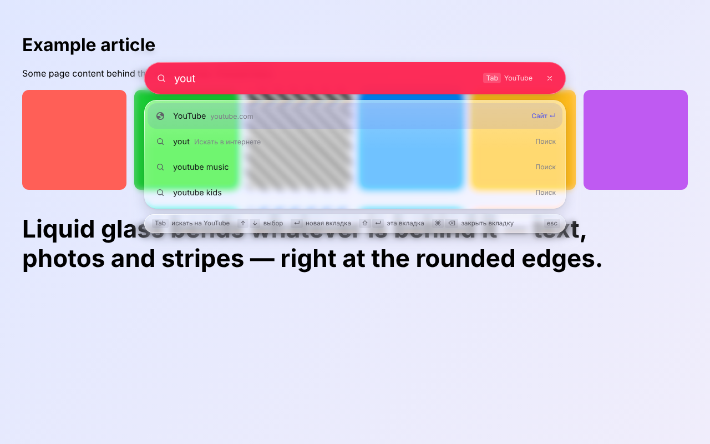
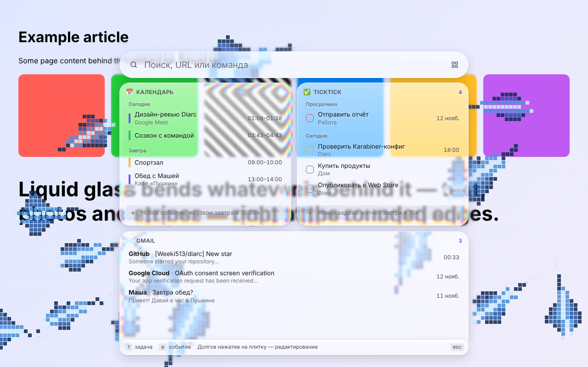
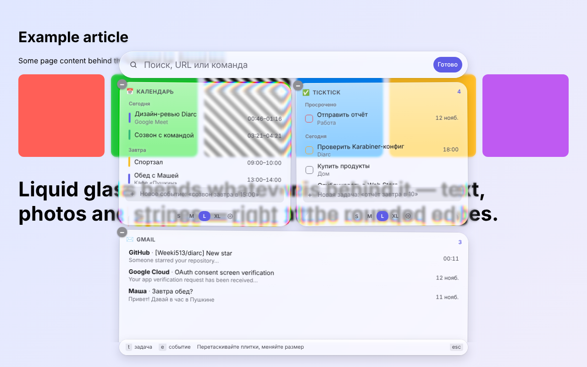

<p align="center"></p>

<h1 align="center">Diarc</h1>

An Arc-style command bar for the [Dia](https://www.diabrowser.com/) browser. Press `⌘T` and a bar appears instantly on top
of the page you're on: search across tabs, history, bookmarks and the web, tab commands, and a grid of widget tiles
(Google Calendar, Gmail, TickTick and your own). Works in any Chromium-based browser.

https://github.com/user-attachments/assets/995e0249-106c-4183-a8a7-9e00c5d6ec33

[Download the latest release](https://github.com/Weeki513/diarc/releases/latest) · [Русская версия](README.ru.md)

## Why

The thing that bugged me in Dia was that opening search always opened a new tab. I wanted the simplicity Arc had back:
`⌘T` there didn't open a new tab, it opened an input right over the current page. I waited a long time for something like
this from The Browser Company, got tired of waiting and built it myself.

I also wanted more freedom and functionality, which is where widgets and the easy way to add your own came from. And a bit
of beauty and self-expression, which is where the ASCII animations came from.

So when I had a couple of free hours, I built this extension. It's on GitHub now and coming to the
[Chrome Web Store](https://chromewebstore.google.com/category/extensions) soon.

<p>
  
  
  
  
</p>

## Features

- **Search** like an address bar: web suggestions (Google or DuckDuckGo, can be turned off), sites, open tabs, bookmarks and
  history in one list. The selected item is ghost-completed in the input; `Tab` or `→` accepts it. `↵` opens in a new tab,
  `⇧↵` in the current one, `⌘⌫` closes the matching tab.
- **Tab to search** like in Arc: type `youtube`, press `Tab`, and your query goes to YouTube. About 30 sites are built in,
  you can add your own in settings, and sites with OpenSearch that you visit are picked up automatically.
- **Site color**: the search bar takes on the color of the site you're about to open (popular domains are predefined,
  the rest come from the favicon).
- **Liquid glass**: the search bar, tiles and footer are separate pieces of glass that refract the page at their edges
  (an SVG filter under the iframe), with one light that follows the cursor and scroll. Tune it with sliders and a live
  preview, switch to frosted glass, or turn it off.
- **Creatures**: pixel ASCII creatures (mantas, fireflies, swallows, turtles, leaves) drift over pages under the bar's
  glass or in an "Aquarium" tab. Everything is configurable, and you can add your own in one file:
  **[docs/CREATURES.md](docs/CREATURES.md)**.
- **Action menu** on `⌘J`, like the `⌘K` menu in Raycast: toggle creatures and pick a species, switch glass, theme and suggestions,
  edit tiles, sign in or out of Google and TickTick, open settings; plus actions for the selected result (copy link,
  open in a new window, remove from history, close or pin a tab).
- **Commands**: close, duplicate or pin a tab, close duplicates, move to a new window, copy the link and more.
- **Quick capture**: `t buy milk tomorrow` creates a TickTick task, `e call friday 3pm 30 min` creates a Google Calendar
  event. Dates are understood in English and Russian.
- **iOS-style widget tiles**: long-press (or ▦) to edit; drag, resize (S, M, L, XL), configure and add tiles.
  - **Google Calendar**: today's and tomorrow's events; create, rename, reschedule, delete, join Meet.
  - **TickTick**: today's and overdue tasks; complete, add, rename, delete.
  - **Gmail**: unread mail. The simple mode needs no setup; the Gmail API mode adds archive and mark-as-read.
  - **Quick links**, **Weather** and any widgets you write.
- No new tab involved. On pages an extension can't draw on (new tab, `dia://`, Web Store, PDF) the bar opens as a tab.

> The interface is in Russian for now.

## Speed and footprint

- The content script is 3.6 KB and draws nothing until you need the bar.
- The bar lives in an isolated extension iframe. It is preloaded in the active tab while the browser is idle, so opening it
  is just a visibility toggle (~20 ms in tests). Tabs hidden for more than 5 minutes release the memory.
- Widget data is cached and shown instantly; it refreshes in the background (every 3–10 minutes, and on open if older than a minute).
- The whole UI is Preact, about 25 KB gzipped.
- Pages can't see your mail, events or keystrokes in the bar: everything is rendered inside the extension frame.

## Install

Until Diarc is in the Chrome Web Store, install it from a release:

1. Download `diarc-<version>.zip` from [Releases](https://github.com/Weeki513/diarc/releases/latest) and unzip it.
2. In Dia, open `dia://extensions` and turn on **Developer mode** (top right).
3. Click **Load unpacked** and pick the unzipped folder (the one with `manifest.json`).
4. Open any page and press `⌃⇧Space`.

> **For `⌘T`, we recommend the free [Karabiner-Elements](https://karabiner-elements.pqrs.org/).** Ready-made rules are in
> `karabiner/diarc.json`; see [Keyboard shortcut](#keyboard-shortcut) below.

Don't delete the folder after installing: Dia loads the extension straight from it. To update, replace the folder's
contents with a new release and press ↻ on the extension.

### From source

```bash
git clone https://github.com/Weeki513/diarc && cd diarc
npm install
npm run build
```

In Dia, open `dia://extensions`, turn on **Developer mode**, click **Load unpacked** and pick the `dist` folder.
`npm run dev` rebuilds on changes (press ↻ on the extension after a rebuild).

### Keyboard shortcut

Extensions can't take `⌘T`, so by default the bar opens with **`⌃⇧Space`** (change it at `dia://extensions/shortcuts`).
To get `⌘T` like in Arc, use the free [Karabiner-Elements](https://karabiner-elements.pqrs.org/):

1. Copy `karabiner/diarc.json` to `~/.config/karabiner/assets/complex_modifications/`.
2. Karabiner → **Complex Modifications → Add predefined rule** → enable both Diarc rules:
   - `⌘T` → `⌃⇧Space` (opens the bar),
   - `⌘K` → `⌘T` (Dia's regular new tab).

The rules only apply while Dia is focused. If nothing happens, check Dia's bundle id in Karabiner-EventViewer
(Frontmost Application tab) and fix `bundle_identifiers` in the file (currently `company.thebrowser.dia`).
If you changed the shortcut at `dia://extensions/shortcuts`, change the rule too.

### Accounts

Google and TickTick need OAuth clients that you create yourself. Step by step: **[docs/OAUTH.md](docs/OAUTH.md)**.
Without them, search, links, weather and Gmail in simple mode all work.

## Your own widgets

A widget is one file, `src/widgets/<id>/index.tsx`, picked up automatically.

```bash
npm run new-widget -- hn "Hacker News"
npm run build
```

The full contract and examples are in **[docs/WIDGETS.md](docs/WIDGETS.md)**. The easiest way is to hand it to an AI agent:
give Claude Code or Cursor a task like "make a Diarc widget that shows …" and point it at that file. The same works for
creatures with [docs/CREATURES.md](docs/CREATURES.md).

## Publishing

How to publish to the Chrome Web Store for free (apart from the one-time $5 developer fee):
**[docs/PUBLISHING.md](docs/PUBLISHING.md)**. Privacy policy: [docs/PRIVACY.md](docs/PRIVACY.md).

## Project layout

```
src/
  content/      content script: hidden iframe in a closed shadow root, show/hide, liquid glass layer
  pages/        overlay.html (the bar), options.html (settings), ambient.html (creatures)
  ui/           Preact UI of the bar, search, tile grid, widget UI kit
  ambient/      creature engine and creatures (one file each)
  background/   service worker: shortcut, fallback window, widget refresh, OAuth
  shared/       shared types, widget API, storage, date parsing
  widgets/      widgets (one folder each)
karabiner/      Karabiner-Elements rules
scripts/        build, icons, widget and creature templates, e2e test
```

`npm run typecheck` checks types; `npm run test:e2e` (needs Playwright) runs the scenario in Chromium and saves screenshots.

## License

MIT
